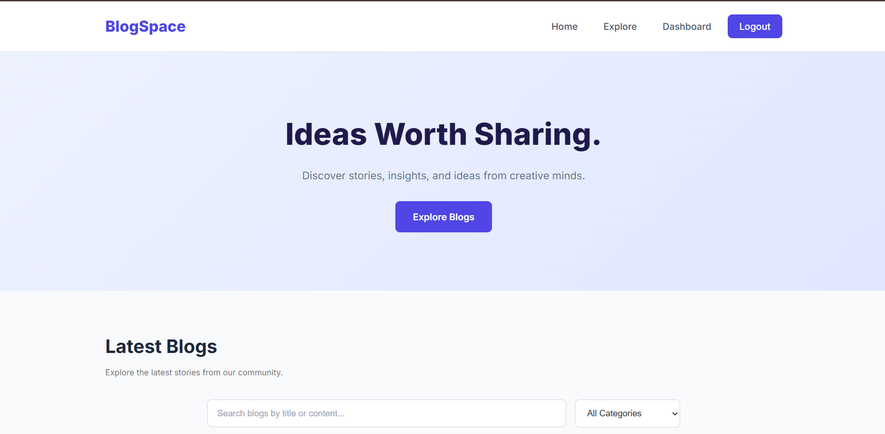
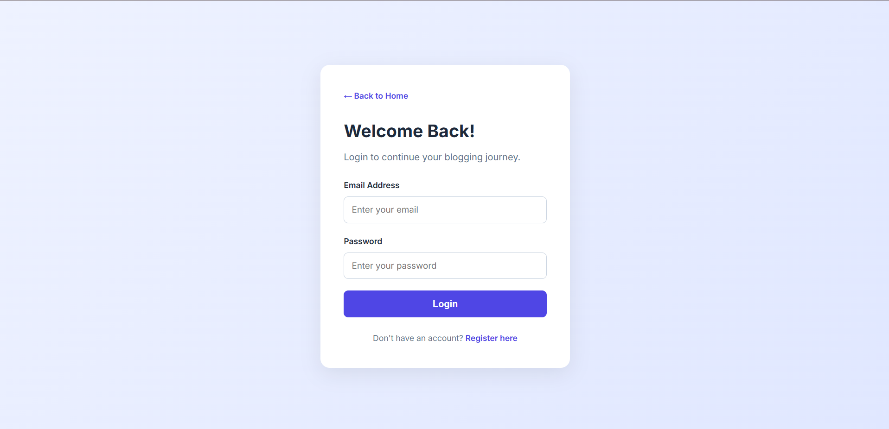
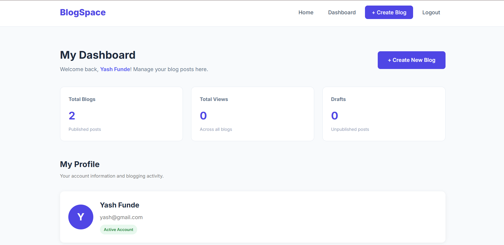
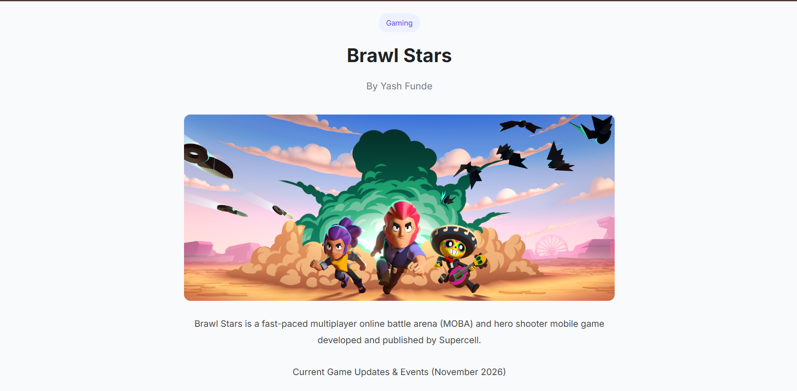

# BlogSpace – Full Stack Blog Application

A responsive full-stack blog application developed as part of my **Full Stack Web Development Virtual Internship at Codomax Digital Solutions**.

BlogSpace allows users to register, log in, create and manage their own blog posts, and explore content published by the community.

## Features

## Screenshots

### Homepage


### Login Page


### Dashboard


### Blog Details


### Frontend
- Responsive homepage and navigation
- User registration and login
- Dynamic blog display
- User dashboard and profile
- Create, edit, and delete blog posts
- Search blogs by title and content
- Filter blogs by category
- User-specific blog management
- Protected dashboard and create-blog pages
- Profile statistics

### Backend
- RESTful APIs using Express.js
- JWT-based authentication
- Password hashing using bcryptjs
- Authentication middleware
- Blog CRUD operations
- MongoDB Atlas integration
- User-specific blog retrieval
- Environment variable configuration

## Technologies Used

| Technology | Purpose |
|---|---|
| HTML5 | Page structure |
| CSS3 | Styling and responsive design |
| JavaScript | Frontend functionality |
| Node.js | Backend runtime |
| Express.js | Backend framework |
| MongoDB Atlas | Cloud database |
| Mongoose | Database modeling |
| bcryptjs | Password hashing |
| JSON Web Token | Authentication |
| dotenv | Environment variables |
| CORS | Frontend-backend communication |
| Git & GitHub | Version control |

## Project Structure

```text
BlogSpace/
│
├── index.html
├── login.html
├── register.html
├── dashboard.html
├── create-blog.html
├── blog-details.html
│
├── css/
│   └── style.css
│
├── js/
│   ├── config.js
│   └── script.js
│
├── backend/
│   ├── config/
│   │   └── db.js
│   ├── models/
│   │   ├── User.js
│   │   └── Blog.js
│   ├── controllers/
│   │   ├── authController.js
│   │   └── blogController.js
│   ├── routes/
│   │   ├── authRoutes.js
│   │   └── blogRoutes.js
│   ├── middleware/
│   │   └── authMiddleware.js
│   ├── server.js
│   ├── package.json
│   └── .gitignore
│
└── README.md
```

## Installation and Setup

### 1. Clone the repository

```bash
git clone https://github.com/YashFunde/BlogSpace.git
```

### 2. Open the project

Open the cloned project folder in VS Code.

### 3. Install backend dependencies

```bash
cd backend
npm install
```

### 4. Configure environment variables

Create a `.env` file inside the backend folder:

```env
PORT=5000
MONGODB_URI=your_mongodb_connection_string
JWT_SECRET=your_secure_secret_key
```

Replace the placeholder values with your own credentials. Never upload your `.env` file to GitHub.

### 5. Start the backend server

```bash
npm run dev
```

The backend will run at:

`http://localhost:5000`

### 6. Run the frontend

Install the Live Server extension in VS Code and open `index.html` using Live Server.

Make sure `js/config.js` points to your backend API:

```javascript
const API_URL = "http://localhost:5000/api";
```

## API Endpoints

### Authentication APIs

| Method | Endpoint | Description |
|---|---|---|
| POST | `/api/auth/register` | Register a new user |
| POST | `/api/auth/login` | Login user |
| GET | `/api/auth/profile` | Get logged-in user's profile |

### Blog APIs

| Method | Endpoint | Description | Authentication |
|---|---|---|---|
| GET | `/api/blogs` | Get all blogs | No |
| GET | `/api/blogs/my-blogs` | Get user's blogs | Yes |
| POST | `/api/blogs` | Create a blog | Yes |
| PUT | `/api/blogs/:id` | Update a blog | Yes |
| DELETE | `/api/blogs/:id` | Delete a blog | Yes |

Protected endpoints require a JWT Bearer token in the Authorization header.

## Module 03 – MongoDB Integration

- Integrated MongoDB Atlas using Mongoose.
- Created User and Blog models.
- Stored user passwords securely using bcrypt hashing.
- Connected blog CRUD operations with MongoDB.
- Added blog image URL support.
- Displayed blog posts with author information.
- Implemented data persistence.

## Module 04 – CRUD Operations and Blog Filtering

- Create, read, update, and delete blog posts.
- View individual blog details.
- Search blogs by title and content.
- Filter blogs by category.
- Combine search and category filtering.
- Display messages when no matching blogs are found.

## Module 05 – Authentication and Dashboard

- Secure user authentication using JWT.
- Password hashing using bcrypt.
- Protected routes for authenticated users.
- User-specific blog management.
- User profile displaying name, email, and account creation date.
- Profile statistics:
  - Total Blogs
  - Categories Used
  - Latest Blog
  - Member Since
- Logout functionality.
- Automatic redirection to login for unauthorized access.

## Module 06 – Final Project and Deployment

- Final application testing.
- UI improvements and mobile responsiveness.
- Professional project documentation.
- Application deployment.


## Internship

**Organization:** Codomax Digital Solutions  
**Program:** Full Stack Web Development Virtual Internship  
**Project:** BlogSpace – Full Stack Blog Application

---

Developed as part of my Full Stack Web Development learning journey.
